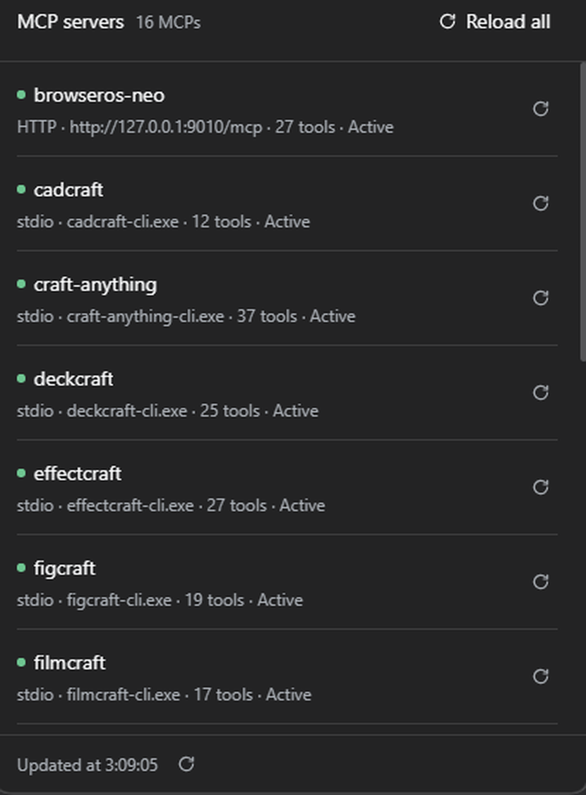

# Plugins para DeepSeek Harness

Colección de plugins para la interfaz web de [DeepSeek Harness](https://deepseek.com) (DSH).
Cada plugin vive en `plugins/<nombre>/` y se instala en un perfil de DSH con los scripts de `scripts/`.

> **No es un proyecto oficial de DeepSeek.** Son herramientas de usuario que se enganchan a los
> puntos de extensión públicos de DSH. Probado con la build de escritorio de noviembre de 2026 en
> Windows.

Idioma: español. Resumen en inglés al final.

## Plugins

### [`dsh-mcp-console`](plugins/dsh-mcp-console/README.md) — ver y recargar los servidores MCP

Añade un botón `MCP <n>` en la fila de estadísticas del compositor. Al pulsarlo se abre un panel
con los servidores MCP cargados en el perfil: transporte, destino, estado y número de tools, con
un botón para **recargar uno** o **recargar todos** sin reiniciar la aplicación.



- Lista los servidores leyendo el árbol del Loader, sin caché: se ve lo que está cargado de verdad.
- Recarga = ciclo de la fibra de esa fila: mata y vuelve a arrancar la conexión de **ese** servidor,
  sin tocar su configuración ni los demás.
- Recarga en masa **en serie**, con progreso por fila y timeout por servidor.
- No edita, añade ni borra servidores: solo lista y recarga.

## Requisitos

- **Windows** con PowerShell 5.1 o superior (los scripts usan `robocopy` y validateadores en Node).
- **DeepSeek Harness de escritorio** con al menos un perfil (por defecto el script usa `desktop`).
- Node.js para las comprobaciones de sintaxis. Si DSH está instalado, ya trae uno; el script también
  lo busca en la instalación.

## Instalación rápida

```powershell
git clone https://github.com/fxMT-nx/plugins-dsh.git
cd plugins-dsh

# 1) ver qué haría, sin escribir nada
powershell -NoProfile -ExecutionPolicy Bypass -File scripts\install-mcp-console.ps1 -DryRun

# 2) instalar de verdad
powershell -NoProfile -ExecutionPolicy Bypass -File scripts\install-mcp-console.ps1
```

Después, **recarga la página de la GUI** (F5) y busca el botón `MCP <n>` a la izquierda del contador
de turnos, bajo el compositor. Hace falta tener una conversación abierta: ese hueco de la interfaz
solo existe ahí.

Si tu perfil no se llama `desktop`, pásalo: `-ProfileName otro`.

## Desinstalar

```powershell
powershell -NoProfile -ExecutionPolicy Bypass -File scripts\uninstall-mcp-console.ps1
```

Quita la fila del patch del perfil y la copia instalada, y verifica que el patch vuelve a su estado
anterior. Hace backup antes de tocar nada.

## Cómo está montado esto

```
plugins/<nombre>/        El plugin: package.json con dsh.client + índice maestro
scripts/                 Instalación, desinstalación y verificación (PowerShell)
```

Un plugin de DSH es un paquete con dos mitades: una que corre en el proceso **Host** (Node) y otra
que se sirve al **navegador** como bundle diferido. Los scripts lo copian al perfil y añaden una
fila al `cordis.patch.yml` del perfil. **La capa global (`~/.dsh/cordis.patch.yml`) no se toca
nunca**: si algo va mal, el resto de perfiles siguen arrancando.

## Avisos

- Los plugins se **copian** al perfil, no se enlazan. Editar el repo no cambia lo que corre: hay que
  volver a ejecutar el script (`-Update` para solo la mitad cliente).
- Cambiar la mitad **Host** exige **recrear la fila** (uninstall + install), no basta con copiar el
  fichero: los módulos del Host se importan al crear la fila.
- Usa esto bajo tu responsabilidad: recargar un servidor MCP mata el proceso de ese servidor.

## Licencia

MIT. Ver [`LICENSE`](LICENSE).

---

### English summary

Plugins for the DeepSeek Harness web UI. Today: `dsh-mcp-console`, which lists the MCP servers
loaded in a profile (transport, target, state, tool count) and reloads one or all of them with a
click, cycling that row's fiber without touching configuration. Windows only for now (PowerShell
scripts). MIT licensed. Not affiliated with DeepSeek.
