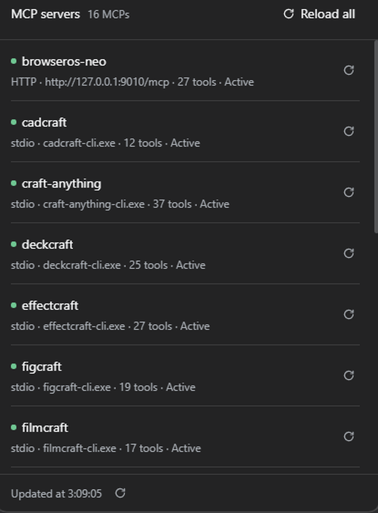

# dsh-mcp-console

Panel para ver y recargar los servidores MCP cargados en un perfil de
[DeepSeek Harness](https://deepseek.com), desde la propia interfaz web.



Un botón `MCP <n>` en la fila de estadísticas del compositor (a la izquierda del contador de turnos)
abre un panel con los servidores MCP del perfil: transporte, destino, estado y número de tools.
Desde ahí puedes **recargar uno** o **recargar todos**.

## Qué hace y qué no

Hace:

- Lista los servidores leyendo el árbol del Loader en cada lectura — sin caché: enseña lo que está
  cargado de verdad, no lo que dice el fichero de configuración.
- Recarga un servidor: cicla la fibra de esa fila, así que su conexión se destruye y se recrea con la
  misma configuración. En `stdio` eso mata el proceso hijo y arranca otro.
- Recarga todos **en serie**, con progreso `n/total`, timeout por servidor y un fallo que no aborta
  el resto.

No hace (v1):

- No edita, añade, borra ni activa servidores.
- No guarda historial entre reinicios ni muestra los logs del servidor.
- No recarga nada solo porque un servidor se caiga.

## Estados

| Punto | Texto | Significado |
|---|---|---|
| verde | `Active` | conectado y con catálogo de tools |
| ámbar | `No catalogue` | la fila está activa pero no tiene tools: arrancó sin catálogo. Es degradado, no fallo |
| rojo | `Failed` | la fila falló al activarse |
| gris | `Starting…` / `Reloading…` / `Stopping…` / `Pending` | en tránsito |
| atenuado | `Disabled` / `Unknown` | fila desactivada o estado no reconocido |

El color va en el texto de la línea descriptiva, no en un marco de color: un servidor degradado se
lee por su punto ámbar, sin ruido visual.

## Instalar

Desde la raíz del repositorio:

```powershell
# ver el plan sin escribir nada
powershell -NoProfile -ExecutionPolicy Bypass -File scripts\install-mcp-console.ps1 -DryRun

# instalar
powershell -NoProfile -ExecutionPolicy Bypass -File scripts\install-mcp-console.ps1

# instalar en otro perfil
powershell -NoProfile -ExecutionPolicy Bypass -File scripts\install-mcp-console.ps1 -ProfileName mi-perfil
```

Hace backup del `cordis.patch.yml` del perfil, copia el paquete a
`<perfil>\node_modules\@local\dsh-mcp-console`, añade **una** fila al patch (idempotente) y verifica
hashes. La capa global `~/.dsh/cordis.patch.yml` no se toca nunca.

Después, **recarga la página de la GUI**. El botón solo aparece con una conversación abierta: ese
hueco del compositor no existe en la pantalla de sesión nueva ni en Ajustes.

## Actualizar

```powershell
git pull
powershell -NoProfile -ExecutionPolicy Bypass -File scripts\install-mcp-console.ps1 -Update
```

`-Update` resincroniza la copia instalada. **Suficiente para cambios de la mitad cliente** (el
bundle del navegador). Si lo que cambia es la mitad **Host** (`index.js`), los módulos del Host se
importan al crear la fila: hay que recrearla.

```powershell
powershell -NoProfile -ExecutionPolicy Bypass -File scripts\uninstall-mcp-console.ps1
powershell -NoProfile -ExecutionPolicy Bypass -File scripts\install-mcp-console.ps1
```

## Verificar

```powershell
powershell -NoProfile -ExecutionPolicy Bypass -File scripts\verify-mcp-console.ps1
```

Comprueba el patch, la fila, la copia (hashes repo↔instalado), la sintaxis, los procesos MCP vivos y
que la GUI responde. Sale con `0` si todo está bien, `30` si hay avisos y otros códigos por fallo.
`-Json` para consumo desde scripts.

> La **validación profunda** del patch (componer las capas con el propio `dsh-app-boot` de la
> instalación) solo está disponible si tienes un espejo de la aplicación en `recon/asar/` junto al
> repo. Sin él, el script avisa (`la validacion profunda se omite`) y sigue: valida sintaxis, forma y
> composición básica, no la composición completa.

## Desinstalar

```powershell
powershell -NoProfile -ExecutionPolicy Bypass -File scripts\uninstall-mcp-console.ps1
```

Quita solo la fila de este plugin y su copia, y verifica que el patch vuelve a su estado anterior
(por hash). Idempotente. `-KeepCopy` conserva los ficheros; `-RestoreBackup` restaura el backup más
reciente.

## Configuración de la fila

La fila del patch admite dos opciones:

```yaml
- insert:
    - id: mcp-console
      name: '@local/dsh-mcp-console'
      config:
        reloadTimeoutMs: 30000   # por servidor, al recargar en masa
        onlyServers: []          # ids del Loader a incluir en "recargar todos"; vacío = todos
```

## Cómo funciona

Dos mitades en un paquete:

- **Host** (`index.js`): servicio `mcpConsole` con cuatro métodos — `servers()`, `restart(id)`,
  `restartAll()`, `health()`. `servers()` recorre `ctx.loader.entries()` y se queda con las filas de
  `@deepseek-ai/dsh-mcp-client`; el número de tools sale de contar las registradas con prefijo
  `mcp__<servidor>__`. `restart()` hace `entry.fiber.restart()`, que es el mecanismo del propio
  kernel para reciclar un plugin con su configuración actual.
- **Cliente** (`client.js`): bundle diferido que registra el botón en el hueco
  `conversation.composer.dock` y el panel en `shell.overlay`. Todo el estilo va con los tokens
  semánticos de DSH (`--dsw-alias-*`), así que sigue el tema claro/oscuro de la aplicación.

Detalle que cuesta descubrir y está resuelto aquí: un namespace de Remote (`remote.mcpConsole`) no se
lee como propiedad de `ctx.remote` si la fibra no lo declara. Hay que montar la contribution y
**después** inyectar la dependencia (`ctx.inject(['remote.mcpConsole'], …)`), leyéndola con
`ctx.get(...)`. Si se pone en el `inject` del módulo, la fibra nunca arranca porque espera el
namespace que ella misma crea.

## Límites conocidos

- **El contador del botón no es instantáneo**: se refresca cada 20 s y al volver a la ventana (no hay
  evento del Host que avise de que la lista cambió).
- **Al quitar una fila, el panel puede seguir contándola hasta el siguiente refresco.** Y si el
  servidor nunca completó el handshake MCP, al retirar su fila puede quedar un proceso hijo huérfano
  y la fibra atascada en la baja; se resuelve matando ese proceso. Es comportamiento del cliente MCP
  de DSH, no del panel.
- **El panel va en el idioma de la aplicación** (el locale del host). Los textos del bundle están en
  inglés y en español, pero el español solo se verá cuando el host esté en español.
- **Solo Windows** por ahora: los scripts de instalación son de PowerShell.
- Requiere una build de DSH que tenga `conversation.composer.dock` y `shell.overlay`, y el sistema de
  módulos de cliente (`dsh-client-modules`). Probado con la build de escritorio de noviembre de 2026.

## Licencia

MIT. Ver [`../../LICENSE`](../../LICENSE).
